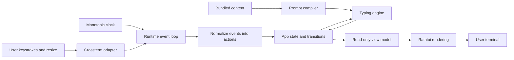
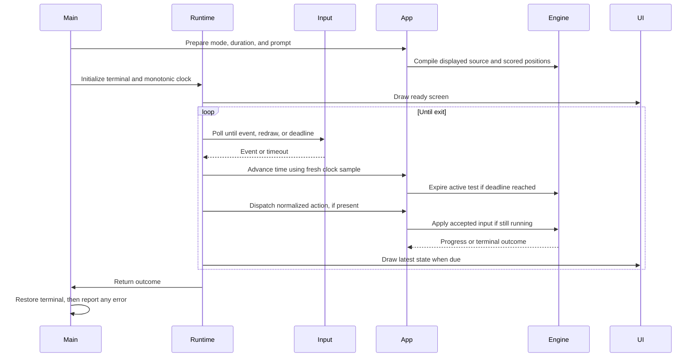
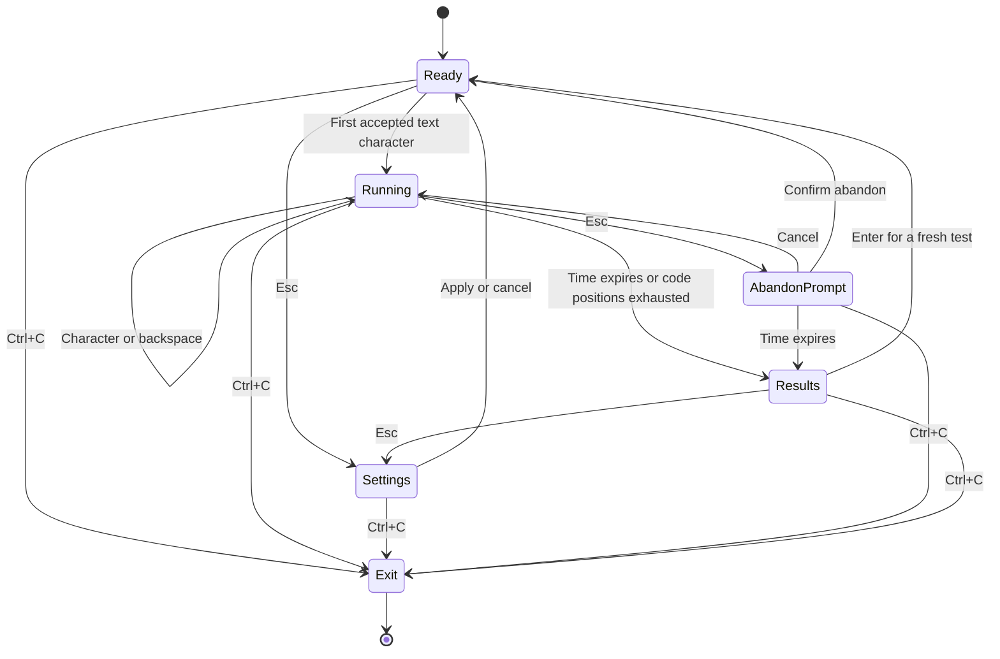
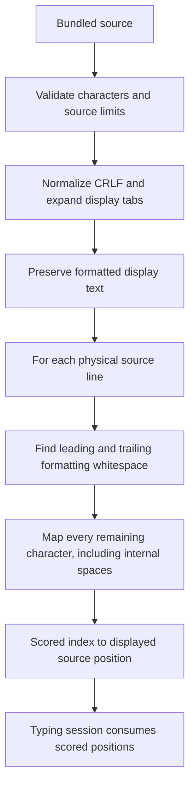

# monkeytype-tui: system design

Status: first implementation exists and is automated-tested on Linux. Product
requirements below reflect the design discussion; formulas, the provisional
60-second default, ASCII scope, and UX policies remain open to product review.
Performance figures below are targets, not measured guarantees.

Current evidence: 25 Rust engine/input/application/rendering tests (including
56 fixture examples and generated invariant checks), 13 fast PTY scenarios,
and a separate real 30-second timeout scenario pass in this workspace. Formatting
and Clippy with warnings denied also pass. macOS and real-emulator theme/font
checks have not been run. See [README.md](README.md) for commands.

## 1. Interview opening: explain the system in one minute

We are building an offline terminal typing trainer with word and code modes.
The user chooses a 30-second, 60-second, or 2-minute test. Code remains visually
formatted, but indentation and trailing whitespace are skipped; spaces inside
lines and punctuation must be typed. A code test ends when time expires or the
snippet has been attempted, whichever happens first.

The design is a single Rust process with one event loop and one state owner.
Terminal input becomes application actions, a deterministic engine updates the
test, and Ratatui renders the resulting state. The engine does not depend on the
terminal, clock hardware, filesystem, or network. This makes the scoring rules
easy to test and avoids concurrency in the latency-sensitive path.

The hardest parts are accurate timing, mapping formatted code to scored input,
fair correction rules, and restoring the terminal after errors. Those deserve
more attention than distributed infrastructure for this product.

## 2. Requirements and boundaries

### Confirmed functional requirements

| Area | Required behavior |
| --- | --- |
| Modes | Switch between words and short formatted code snippets. |
| Layout | Instrument: visible time, WPM, accuracy, errors, and prompt. Exact placement remains adjustable. |
| Appearance | Use the user's terminal theme, colors, and font; no special terminal setup. |
| Duration | Offer 30 seconds, 60 seconds, and 2 minutes. Implementation provisionally selects 60 seconds. |
| Code whitespace | Skip indentation and trailing whitespace on each line; require internal spaces. |
| Code symbols | Type punctuation and symbols such as colons, braces, and brackets normally. |
| Mistakes | Allow forward progress and mark errors; report error count and accuracy. |
| Code termination | End on time expiry or snippet completion, whichever comes first. |
| Platforms | Linux and macOS first. |
| History | Deferred. `// TODO: add saved aggregate history after the first release.` |

Automatic movement across code line breaks is the proposed interpretation of
"like word typing, but looking like code." Enter is not required to reproduce
formatting. The exact metric and correction rules in section 7 are proposed,
not a claim of matching Monkeytype's implementation.

### Nonfunctional requirements

- Correctness: ignored formatting cannot affect cursor progression or scoring.
- Responsiveness: target input-to-visible-feedback below 50 ms in a local
  terminal under ordinary load. This is a target to measure, not a benchmark.
- Efficiency: block while idle; avoid busy loops, unbounded queues, and input-path
  I/O beyond terminal access.
- Reliability: restore terminal modes on normal exit, recoverable errors, and
  unwinding panics. Forced termination and terminal disconnection have limits.
- Privacy: no network requests, telemetry, raw-input logs, environment-file reads,
  or secret inspection. Typed snippets are never executed.
- Accessibility: use underlines/text cues as well as palette colors; support a
  readable small-terminal fallback.
- Reproducibility: stable toolchain, application lockfile, small dependency set.

### First-release exclusions

Accounts, cloud synchronization, leaderboards, code execution, full editor
navigation, plugins, and saved history are outside the initial design. Persistent
settings can also wait: settings may live in memory for the process lifetime.
This avoids choosing a storage format before there is a persistence requirement.

### Interview sizing

This is one interactive user per process. Ten thousand installations mean ten
thousand independent local processes, not ten thousand requests to a shared
service. There is no server capacity, availability quorum, or database sharding
problem in the first release.

Let `N` be scored prompt positions and `S = columns × rows` terminal cells.
Prompt preparation is `O(N)` for a bounded input; code typing and backspace are
`O(1)` per accepted character after preparation. Word-mode replenishment is
amortized across bounded chunks; worst-case redraw is `O(S)`. Source,
position mapping, and the current attempt buffer take `O(N)` memory. Corpus size
is an additional fixed cost. Set explicit corpus/prompt size bounds before
supporting user-imported material; do not retain every historical keystroke.

## 3. Technology choices

| Layer | Proposed choice | Why |
| --- | --- | --- |
| Language | Stable Rust, edition 2024 | Ownership and typed state transitions support a small, memory-safe application. Forbid unsafe in application crates. |
| UI | Ratatui | Cell-based layout and rendering; testable without a real terminal. |
| Terminal backend | Compatible Crossterm | Keyboard events, resize, polling, and terminal control. |
| Execution | Synchronous event loop | Work is local and bounded; no concurrency is needed for typing and drawing. |
| Timing | `std::time::Instant` at the boundary | Monotonic elapsed time, converted to injected durations for engine tests. |
| Content | Bundled licensed text/snippets | Offline, reproducible, no downloads or code execution. |
| Tests | Rust unit tests, Ratatui TestBackend, PTY E2E harness | Separate logic correctness, rendering, and real process behavior. |

The verified stack snapshot from this discussion is Rust 1.99.1, Ratatui 0.30.2,
and Crossterm 0.29. Recheck stable patch releases before scaffolding; then pin
the selected toolchain and commit `Cargo.lock`. Ratatui documents the compatible
backend pair in its [installation guide](https://ratatui.rs/installation/).
The Rust version comes from the [official 1.99.1 announcement](https://blog.rust-lang.org/2026/10/15/Rust-1.99.1/).

Rust reduces memory-safety risks; it does not establish that dependencies,
terminal handling, or application logic are secure. Review dependency advisories
and licenses before release.

## 4. High-level design



The runtime owns effects: polling, clock sampling, and terminal drawing. The
application owns the selected mode, duration, screen, and active test. The engine
owns expected positions, attempted characters, counters, and finish rules.
The renderer only reads a view of those values.

This is a modular monolith using Model–Update–View principles. Modules provide
boundaries without introducing services or a framework. Ratatui describes this
separation in its [Elm architecture guide](https://ratatui.rs/concepts/application-patterns/the-elm-architecture/).

### Main execution workflow



Expiration is checked again using a fresh time sample before accepting input.
An event received exactly at the deadline cannot extend the session. Input time
means application processing time; ordinary terminal events do not give us a
portable hardware keypress timestamp.

### Screen and session transitions



Settings apply to a fresh test. Abandoning is not completing a test. While an
abandon prompt is open, the active timer continues; canceling cannot provide
free thinking time. These shortcuts and interruption rules are proposed UX
details. Printable characters such as `q`, `:`, and `[` must remain typing input
rather than global shortcuts during practice.

## 5. Low-level design: modules and contracts

Implemented repository structure:

```text
src/
  main.rs                 startup, terminal scope, error exit
  lib.rs                  module exports and integration-test entry points
  runtime.rs              synchronous loop and clock/event adapters
  terminal.rs             terminal lifecycle, cleanup, capability boundary
  input.rs                terminal events -> domain actions
  app.rs                  screen transitions, settings, session ownership
  content.rs              original bundled word/snippet exercises and selection
  engine/
    mod.rs                prepared/active sessions and outcomes
    prompt.rs             formatted display -> scored positions
    metrics.rs            pure calculations from counters and elapsed time
  ui.rs                   Instrument prompt, results, settings, and overlays
tests/
  engine.rs               JSON fixture runner and domain/invariant tests
  transitions.rs          application behavior without a terminal
  rendering.rs            TestBackend checks
  pty.rs                  custom real-process runner and ANSI screen assertions
  support/fixture_app.rs  feature-gated deterministic/failure-injection binary
  e2e/scenarios.json      scenario specifications mapped to the PTY runner
  fixtures/typing-cases.json  scored prompt, session, timing, and metric examples
```

There is one Cargo package exposing the application library and production
binary. The fixture binary requires the `test-support` feature. Keep UI in one
module until screen complexity justifies splitting it. The core engine imports no Ratatui or Crossterm types.

### Conceptual data model

These are design sketches, not copy-paste complete Rust definitions:

```rust
enum Mode { Words, Code }
enum TestDuration { Seconds30, Seconds60, Seconds120 }

struct Settings {
    mode: Mode,
    duration: TestDuration,
}

struct ExpectedUnit {
    character: char,
    display_offset: usize, // Offset in validated, normalized display source
    row: usize,
    column: usize,
}

struct Prompt {
    display: String,             // Includes original visual formatting
    expected: Vec<ExpectedUnit>, // Only positions that must be typed
    scored_at: Vec<Option<usize>>,
    lines: Vec<Range<usize>>,
}

struct Counters {
    attempts: u64,
    correct_attempts: u64,
    backspaces: u64,
    current_correct: usize,
}

enum Phase {
    Ready,
    Running { started_at: Duration },
    Finished { elapsed: Duration, reason: FinishReason },
}

struct Session {
    prompt: Prompt,
    typed: Vec<char>, // Current prefix; next index is typed.len()
    counters: Counters,
    settings: Settings,
    phase: Phase,
}

enum Screen {
    Practice(Session),
    Settings { draft: Settings, field: usize, original: Box<Session> },
    Results(Report),
}

enum Action { Text(char), Backspace, Confirm, Cancel, Quit /* plus menu/resize actions */ }
enum FinishReason { Timeout, SnippetExhausted }
```

`App` owns `Screen` plus optional presentation state such as an abandon dialog.
Only the runtime reads `Instant`. It passes durations measured from a process
clock origin into application/engine methods. A session stores its start offset
and derives elapsed time from those values. Deterministic tests supply the same
offsets directly. There is no second independently mutable countdown.

Useful contracts:

| Operation | Contract |
| --- | --- |
| `Prompt::new(source, mode)` | Validate source and build display/scored mapping; reject an empty scored prompt. |
| `Session::new(prompt, duration)` | Create a ready test. The first accepted character in `apply` starts timing and is processed once. |
| `Session::advance_time(now)` | Freeze a timeout outcome when elapsed reaches the limit. |
| `Session::apply(input, now)` | Check time, apply one input, then check completion. `report()` exposes a final outcome. |
| `Metrics::calculate(counters, elapsed)` | Calculate labeled metrics without I/O or hidden time reads. |
| `ui::draw(frame, app, now)` | Read application state and dimensions; draw without changing scored input. |

An engine session freezes on completion. `App::tick` replaces it with its report
in `Screen::Results`, preventing further mutation of a completed test. The final
report is immutable. A state transition must not duplicate the session.

## 6. The key algorithm: formatted code versus required input

### Example

Displayed snippet:

```rust
fn main() {
    let count = 1;
    println!("count: {}", count);
}
```

Required input, shown as a flattened explanation only:

```text
fn main() {let count = 1;println!("count: {}", count);}
```

The screen still shows lines and indentation. Completing `{` moves the caret
to the `l` on the next line automatically. Spaces in `fn main`, `let count`,
around `=`, and inside `"count: {}"` must be typed. No separator is invented
between lines. Blank lines have no scored positions.

### Prompt compilation



Algorithm:

1. Validate source before entering a test. Never emit untrusted escape/control
   sequences as raw terminal output. Normalize CRLF to LF.
2. Preserve line structure. Expand tabs into deterministic display spaces before
   constructing position mappings; a four-column tab stop is the proposed rule.
3. For each code line, skip leading/trailing spaces and expanded tabs in the
   scoring stream. Preserve every character between those edges.
4. Map each required character to its position in the normalized display string.
   Newlines remain display formatting and have no scored entry.
5. Reject prompts containing no required characters.

This is a physical-line whitespace rule, not a language parser. Brackets,
comments, string contents, and operators do not require an AST. Spaces inside
a line remain required even inside string literals.

For word mode, single spaces between generated words are scored normally.
Generate words in bounded chunks, retain the attempted prefix, and append the
next chunk before the caret reaches the end. Word mode ends at the time limit;
it does not end accidentally because an initial text buffer was exhausted.

### Character and display-width policy

The initial implementation uses printable ASCII text plus formatting newlines/tabs in
bundled snippets. Normalize tabs as above; reject ESC, NUL, DEL, and unsupported
control characters. ASCII provides a simple one-column character model, while
still using the terminal's chosen font. Non-ASCII user input can produce a
visible unsupported-input notice without advancing or scoring the attempt.
This is the initial implemented scope, not a permanent product limit.

If Unicode text is included, implement grapheme segmentation and terminal width
mapping before shipping it. Do not silently extend byte indexing to Unicode:
byte offsets, graphemes, and terminal columns are different units. Even in the
ASCII design, display offsets never serve as session cursor positions.

### Correction behavior and invariants

- A printable input character fills the next required position, correct or not.
- A wrong character advances and receives an error mark at that expected
  position. A subsequent character cannot silently realign the target.
- Backspace removes the last attempted position and moves to its mapped display
  location, including across a line boundary. At position zero it is a no-op.
- Historical mistakes remain counted after correction; current error styling
  disappears when that position is corrected.
- Enter/Tab used only as formatting do not advance, count, or start the timer.
  Internal expanded-tab spaces must be typed as spaces under the proposed rule.
- Completion means all required positions were attempted, not necessarily
  attempted correctly. Results still expose remaining incorrect positions.
- `typed.len() <= expected.len()`, and each typed position has exactly one
  expected position. Every mapping refers to valid normalized display source.

The no-insertion/no-deletion alignment model is deliberately simple. Missing an
internal space shifts subsequent attempts until the user backspaces; it is not
automatically forgiven by an edit-distance algorithm.

## 7. Timing and metric contracts

### Timing

The timer starts on the first accepted text input, not on launch, mode selection,
paste, or a formatting key. Use a monotonic start time and compute:

```text
elapsed   = now - started_at
remaining = max(0, selected_limit - elapsed)
```

Before applying any action to an active test, expire it if `elapsed >= limit`.
If an accepted character before the deadline consumes the final code position,
finish immediately with `SnippetExhausted`. Timeout wins at the exact boundary.
Freeze elapsed time and counters on completion. For timeout, report the selected
limit rather than an overshoot caused by redraw scheduling.

### Initial formulas (implemented; open to product review)

Let:

- `A`: total accepted character attempts, including required internal spaces and
  retyped positions; excludes skipped formatting, backspace, and control keys.
- `K`: accepted attempts that matched the expected character at their position
  when typed. Backspace does not erase this historical count.
- `C`: correctly matched positions in the current typed prefix after corrections.
- `U`: incorrectly matched positions in the current prefix.
- `t`: effective elapsed time in minutes.

| Label | Formula | Interpretation |
| --- | --- | --- |
| Accuracy | `100 × K / A` | Historical correctness; mistakes remain visible after correction. |
| Errors | `A - K` | All incorrect attempts, including subsequently corrected errors. |
| Uncorrected | `U` | Incorrect positions remaining in the current buffer. |
| Raw WPM | `(A / 5) / t` | Input throughput including corrections and mistakes. |
| WPM | `(C / 5) / t` | Correct current progress; retyping does not inflate correct progress. |

Use five characters as the word-equivalent unit in both modes. Code WPM includes
required internal spaces and punctuation, while excluding auto-skipped formatting;
label this convention clearly. Backspace counts can be reported separately.
Do not subtract errors a second time from an already correct-progress WPM.

Show an em dash before any attempt or while elapsed time is zero; never show NaN,
infinity, or a fabricated positive elapsed time. Format floats only at the view
boundary, and keep sufficient precision in calculations.

Example: target `abc`; input `a`, `x`, Backspace, `b`; elapsed 10 seconds,
while the session is still running with `c` pending.
`A=3`, `K=2`, `C=2`, `U=0`: accuracy is 66.7%, errors 1, raw WPM 3.6, WPM 2.4.
At completion the error is corrected visually, but it remains in accuracy.

## 8. Terminal input, rendering, and lifecycle

### Event loop scheduling

1. Sample time and settle due expiration before doing other work.
2. Poll until the earlier of the next live redraw and active deadline. Idle
   screens can use a longer bounded wait because input wakes polling immediately.
3. Read available input, normalize it, then sample time again before updating.
4. Update state once per action. Check deadlines during input bursts rather than
   draining an unlimited batch before processing timers.
5. Render changed state at a bounded rate; approximately 30 frames/second during
   a test is a starting target. Render final results promptly.

No fixed sleep follows every keypress. Elapsed time is derived from the clock,
not from a tick counter. All Crossterm `poll`/`read` calls stay on the same thread,
as required by its [event API](https://docs.rs/crossterm/latest/crossterm/event/index.html).

Normalize press events once, ignore releases, and define repeat behavior
explicitly. Implemented behavior: accept text/backspace repeat as input, ignore
repeated menu commands. Some terminal protocols report held keys as ordinary
presses, so portable repeat detection is limited. Support documented basic key
sequences without requiring an enhanced keyboard protocol.

Enable bracketed paste where supported and ignore `Paste` events during a test.
Without terminal paste reporting, ordinary text can be indistinguishable from
typing; do not claim perfect paste detection or anti-cheat protection.

### Appearance and layout

Keep default foreground and background rather than hardcoding an RGB theme.
Use the terminal's ANSI palette sparingly for semantic accents, plus underlines,
labels, and cursor styling. Ratatui exposes default colors through
[`Color::Reset`](https://docs.rs/ratatui/latest/ratatui/style/enum.Color.html).
The terminal controls the font, font size, ligatures, and its background effects;
the app does not load fonts or change terminal configuration.

The Instrument layout contains mode/duration status, time/WPM/accuracy/errors,
the formatted prompt, and shortcut hints. Center the caret's logical position
within a scrolling prompt viewport. Wrapping and resizing affect presentation,
never the expected sequence or scoring. Cache line-to-position information so
redraws do not scan the entire corpus.

The implemented minimum is 40 columns × 12 rows. Below that size, show a resize
message and exit shortcut where space permits. Time continues; text input is
ignored and not scored. Query the actual terminal size before dispatching input:
PTY testing exposed that a draw can observe resized dimensions before a Resize
event reaches the input loop. Real-terminal usability still needs manual review.

### Startup, errors, and cleanup

Validate bundled content and settings before modifying the terminal. Check for
an interactive terminal and give a plain error when invoked through unsupported
pipes. Use the current supported Ratatui lifecycle APIs; its
[terminal documentation](https://docs.rs/ratatui/latest/ratatui/struct.Terminal.html)
recommends the provided lifecycle helpers for the default fullscreen backend.

Pair terminal entry with a cleanup scope, including partial-initialization
failure. Prefer the library's panic-restoration behavior over competing custom
hooks. Restore raw mode, alternate screen, cursor state, and any paste/keyboard
features the app enabled before reporting an error. Cleanup should be idempotent
and avoid panicking while handling another error.

Ctrl+C in raw mode is an application action; OS termination signals are a
different boundary. `signal-hook` sets an atomic shutdown flag for SIGTERM and
external SIGINT; terminal cleanup runs on the normal thread. The locked signal-hook
version is 0.4.5; Crossterm also has its own transitive 0.3 dependency. For v1, Ctrl+Z is handled as an
unsupported suspend command rather than leaving a raw terminal behind.
No program can run cleanup after SIGKILL or power loss. Do not promise otherwise.

## 9. Failure analysis

| Failure or edge case | Intended behavior |
| --- | --- |
| Empty/formatting-only snippet | Reject during preparation, before timing begins. |
| Invalid/control-bearing bundled source | Reject content; never execute or emit raw escape sequences from it. |
| Wrong character or missing internal space | Mark its expected position; continue; allow backspace correction. |
| Backspace over a visual newline | Return to the previous required character, skipping formatting automatically. |
| Input at/after deadline | Freeze timeout result; do not accept the character. |
| Final code character is wrong | Finish when all positions are consumed; show error and accuracy consequences. |
| Time expires during abandon prompt | Finalize results; cannot resume the expired session. |
| Resize or very small terminal | Preserve session state; apply the documented small-window policy. |
| Paste | Ignore reported paste during tests; note terminal protocol limitations. |
| Terminal draw/read failure | Exit through cleanup, then report the error outside raw mode. |
| Panic | Restore through supported panic handling; report the original failure. |
| SIGKILL or terminal disappears | Cleanup cannot be guaranteed; no false recovery promise. |

## 10. Testing strategy and concrete cases

The detailed catalog is in [test-cases.md](test-cases.md). Machine-readable
prompt and session examples are in `tests/fixtures/typing-cases.json`; PTY
scenario specifications are in `tests/e2e/scenarios.json`. The implemented
fixture runner is `tests/engine.rs`; `tests/pty.rs` implements the real-process
scenarios. Verification evidence and limits are recorded below.

### Unit tests: deterministic domain behavior

Inject elapsed durations; no wall-clock sleeps. Keep corpus selection seeded or
fixture-based. Test observable contracts rather than private field names.

| Case | Expected assertion |
| --- | --- |
| `    let n = 1;   ` | Required stream is `let n = 1;`; inner spaces remain. |
| CRLF, blank lines, indentation tabs | Stable normalized display, valid mapping, no phantom scored characters. |
| String containing spaces | Spaces inside the line remain scored. |
| Unsupported controls / empty scored prompt | Preparation fails clearly. |
| Wrong internal space | Advances one position, increments errors, lowers accuracy. |
| Backspace and retype | Restores cursor position; historical errors remain counted. |
| Backspace at start / across line boundary | Safe no-op / correct mapped previous position. |
| First wrong character | Starts the clock and counts exactly once. |
| Tab, Enter, release, or paste in ready state | Does not accidentally start or advance the test. |
| `limit - epsilon`, `limit`, `limit + epsilon` | Accept before deadline; timeout at/after it. |
| Final position consumed before deadline | Finishes immediately, even if incorrect. |
| Input after completion | Frozen report cannot change. |
| Zero attempts or zero elapsed | No NaN, division by zero, or misleading accuracy. |
| Correction example from section 7 | Exactly the documented counters and displayed rounded metrics. |
| Word-buffer replenishment | No lost prefix, inserted separator errors, or premature completion. |

Property checks can generate small prompts and action sequences: cursor bounds,
valid display mappings, `K <= A`, `C + U == typed.len()`, bounded progress, and
immutable finished reports. Introduce a property-testing dependency only if it
adds useful coverage beyond a deterministic case table.

### Application and rendering tests

Exercise mode/duration changes, cancel/apply semantics, abandoning, restart,
and deadline processing while an overlay is open. Use Ratatui TestBackend to
assert meaningful cells and styles at normal, narrow, and tiny sizes. Check
underlines as well as color; screenshot text alone does not prove error styling.
Do not use a full-screen snapshot for every internal transition.

### E2E tests: launch the real binary in a pseudo-terminal

A PTY harness creates an isolated terminal, starts the built binary, sends bytes
for characters and keys, and interprets ANSI output into a screen buffer. It
can resize the PTY and inspect terminal attributes on the slave descriptor.
The dev-only runner uses `portable-pty` 0.9 and `vt100` 0.16.2; JSON examples use
`serde_json`. It first launches a worker with explicitly cleared environment
inheritance because the PTY command builder otherwise enumerates ambient values.
The worker receives only fixed nonsecret terminal/locale/path/shell values.
Fixture and failure-injection launches use a separate feature-gated executable;
the production CLI has no test clock or fixture arguments.

| Scenario | User-level check |
| --- | --- |
| Startup and exit | Ready screen appears; Ctrl+C exits successfully and restores terminal state. |
| Words/code selection | Settings select the requested mode and duration. |
| Code whitespace | Typing trimmed lines with internal spaces completes without indentation/Enter input. |
| Mistakes and correction | Visible mark, changed metrics, and successful backspace correction. |
| Snippet completion | Results appear before the selected limit, with a completion reason. |
| Real timeout | At least one real 30-second process test expires and rejects subsequent typing. |
| Resize | Normal → small → normal preserves progress and the agreed timer policy. |
| Paste event | Bracketed pasted text does not produce normal typing progress. |
| Error/panic cleanup | A test-only failure harness restores raw/echo modes and alternate screen. |
| SIGTERM | Graceful signal path exits and restores the terminal on supported platforms. |

Keep fast clock-boundary coverage in unit/in-process integration tests. A PTY
cannot make the real production binary's `Instant` advance magically; do not
add a hidden production timer-bypass flag just to shorten tests. One real-time
timeout check can run in the slower E2E suite with bounded overall timeouts.
Wait on observable screen states rather than arbitrary short sleeps.

At first-input time, the engine's zero-elapsed contract should be asserted by
unit tests; a PTY screen can already be milliseconds past that point. Parse
terminal output rather than comparing escape-byte sequences, which may differ
between backends or terminal modes. Inspect terminal attributes and emitted
restore sequences; neither alone proves every emulator's visual behavior.

Run unit/rendering checks on Linux and macOS. Run PTY tests where supported and
report skipped platform checks. Manually verify the real terminal's font, light
and dark themes, cursor, and cleanup; a simulated terminal cannot prove those.

Required Rust checks once code exists:

```sh
cargo fmt --check
cargo clippy --all-targets --all-features -- -D warnings
cargo test --locked
```

Implemented commands:

```sh
cargo test --locked --features test-support --test pty
cargo test --locked --features test-support --test pty -- --slow
```

The fast runner covers 13 scenarios; the slow runner covers the real 30-second
clock. All 14 pass on Linux. Fault variants are lifecycle integration tests,
including failure after enabling raw mode but before alternate-screen entry.
The catalog is broader than individually named Rust functions: 25 Rust test
functions cover multiple case IDs and 56 JSON fixture examples. Manual emulator
checks remain pending; do not report the entire catalog as independently passed.

## 11. Alternatives and why we are not choosing them initially

These are tradeoffs for this workload, not claims that the alternatives are bad.

| Alternative | Benefit | Why not initially | Revisit when |
| --- | --- | --- | --- |
| One large `main.rs` | Fastest tiny prototype | Couples timing, input, scoring, and drawing; difficult to test boundaries. | Suitable only for an exploratory throwaway. |
| Traditional MVC with mutable widgets/controllers | Familiar GUI organization | Distributed state ownership makes deadline and scoring invariants harder to enforce. | Many independent editing widgets need rich local behavior. |
| Full component/action framework | Reusable components and standardized composition | Extra abstractions for a few screens; the engine boundary is more valuable now. | Screen count and independent widget state grow substantially. |
| Tokio plus async event stream | Natural network and concurrent I/O integration | No network work exists; task cancellation and shutdown add complexity. | Sync, downloads, or other genuinely concurrent I/O is approved. |
| Input thread + render thread + shared state | Can isolate slow work | Locks, queues, and event ordering complicate deadline handling without demonstrated latency benefit. | Measurements show bounded single-thread work is insufficient. |
| Separate domain/UI Cargo crates | Strong compile-time dependency isolation | More manifests, APIs, and versioning before the boundary has stabilized. | Engine is reused by another frontend or package. |
| Direct ANSI/raw terminal implementation | Full control and fewer UI abstractions | We would own escape handling, rendering differences, resize behavior, and test infrastructure. | Required behavior cannot be represented by the chosen backend. |
| Go with Bubble Tea | Event-loop UI model and straightforward distribution | Rust is the agreed direction and lets this codebase forbid application unsafe code; changing languages adds no current product benefit. | Team expertise or ecosystem requirements change. |
| Python with Textual | Fast UI iteration and a rich framework | Adds an interpreter/framework deployment choice; compiled Rust fits the current stack preference. | Prototyping speed or an existing Python product dominates. |
| Browser/Electron application | CSS typography and familiar web tooling | Changes the requested terminal product and runtime footprint. | A separate desktop/web frontend is requested. |
| SQLite or append-only result files now | Durable history and reporting | History is explicitly deferred; persistence and migrations solve no first-release requirement. | Aggregate history becomes an implemented feature. |
| Language AST/parser for snippets | Syntax-aware selection and highlighting | Typing correctness uses exact characters, not program semantics. | Language-aware exercises or highlighting justify it. |
| Edit distance for live alignment | Can infer missed/extra characters | May hide failures or jump the caret; harder to explain and score consistently. | Adaptive error alignment is explicitly requested. |
| Scoring the raw formatted file | Simplest representation | Violates the requirement to skip indentation and trailing whitespace. | A separate exact-formatting practice mode is requested. |
| Hardcoded RGB themes/custom fonts | Predictable screenshots | Overrides the user's terminal appearance and adds setup. | User explicitly opts into an optional theme; never required. |

## 12. Evolution, observability, and interview follow-ups

### What happens when history is added?

Add a results repository boundary after session completion, outside the hot
input path. Store aggregate report values, duration, mode, content identifier,
metric-definition version, and completion reason. Avoid raw typed text.
Pick an atomic file format for simple append/read needs or SQLite for meaningful
querying; justify the choice against actual requirements. Persistence failure
must not prevent results from being shown or terminal cleanup.

### How would we diagnose slow input?

Measure event handling and rendering separately using opt-in aggregate timings.
Do not log input text, environments, or credentials. Check redraw frequency,
prompt scanning, and output backpressure before introducing threads. Benchmarks
should report terminal dimensions, platform, workload, and limitations.

### What if content is imported later?

Introduce size limits, control-character validation, explicit encoding and
Unicode policy, and license/user-provenance handling before accepting arbitrary
files. Selection should use explicit paths supplied by the user; never scan
environment files, secret directories, or the home directory for content.

### How would this scale to cloud features?

The local engine remains authoritative for its session behavior. A separate,
optional sync boundary could upload aggregate results after user authorization.
Authentication, offline conflict handling, retries, and anti-cheat then become
new design problems. They do not justify a backend for the current app.

### What can we promise about matching the terminal theme?

We can preserve default foreground/background and use terminal-selected palette
entries. We cannot assume those colors have universal RGB values or contrast.
Font selection belongs to the emulator. Text cues and real-terminal checks
remain necessary. No environment or terminal configuration file inspection is
needed to inherit default colors and font.

### What remains for product review and release validation?

1. Review the provisional initially selected duration of 60 seconds.
2. Confirm the proposed formulas/correction rules and the initial character set.
3. Validate shortcut and small-window policies with the actual TUI.
4. Run macOS and manual appearance checks, and measure performance targets.
   Automated coverage is implemented; do not infer unmeasured guarantees from it.

## 13. Implementation milestones and remaining review

1. Implemented: stable Rust package, lifecycle wrapper, and terminal-native view.
2. Implemented: source validation, prompt compilation, and whitespace mapping
   with fixture-backed tests.
3. Implemented: deterministic sessions, timing boundaries, correction, and metrics.
4. Implemented: normalized input and screen transitions in the synchronous runtime.
5. Implemented: Instrument practice, settings, and results views with resize tests.
6. Implemented: PTY coverage and Linux checks. Pending: macOS/manual appearance
   validation, product review of provisional behavior, and a release dependency audit.
7. Keep history as a documented TODO; update this design and `AGENTS.md` as
   behavior becomes implemented or accepted requirements change.
